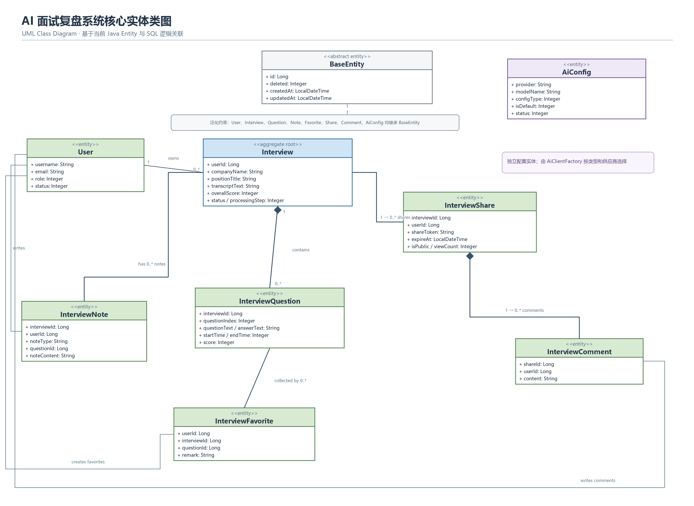
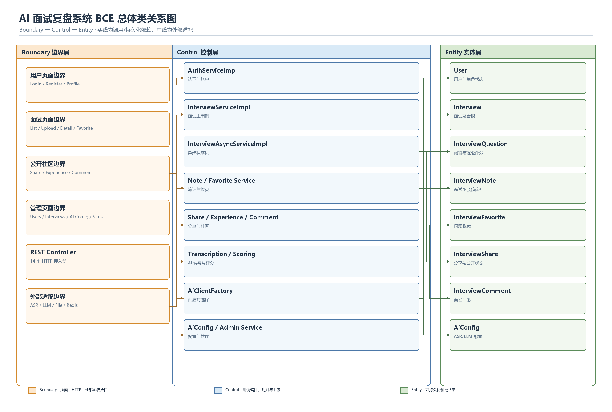
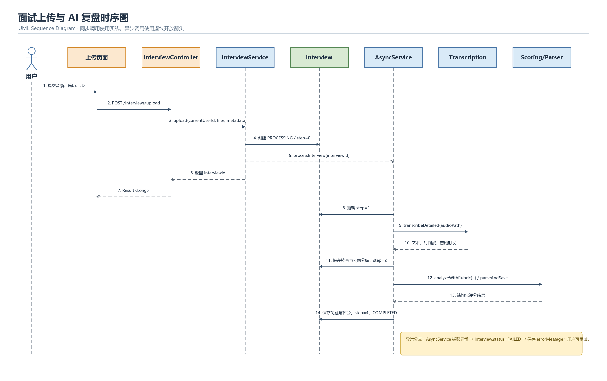
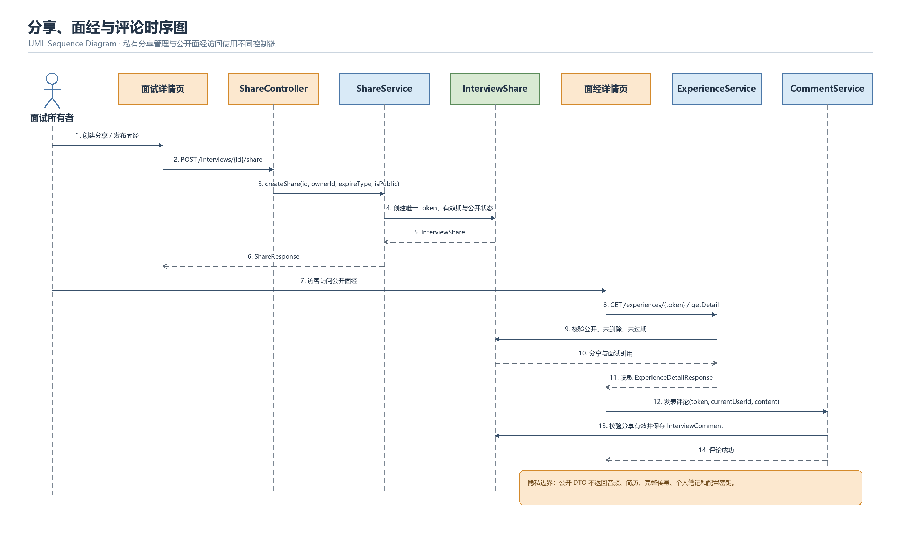

# AI 面试复盘系统类设计方案

| 文档属性 | 内容 |
| --- | --- |
| 项目名称 | AI InterviewReview（AI 面试复盘系统） |
| 文档类型 | 类设计说明书 / BCE 分析类设计 |
| 文档版本 | V1.0 |
| 编制日期 | 2026-10-19 |
| 适用范围 | 后端 `AI_InterviewReview` 与前端 `AI_InterviewReview_front` |
| 设计依据 | 当前 Java、Vue 源码，数据库初始化脚本及模块配置 |

## 1. 文档目的

本文依据当前项目源码，说明系统中的实体类（Entity）、控制类（Control）和边界类（Boundary），描述它们的职责、属性、操作、依赖关系及关键协作过程，为详细设计、类图绘制、编码维护、测试设计和毕业设计/项目评审提供依据。

本文采用 BCE 分析方法，但同时尊重现有工程实现：

- `entity` 包中的持久化对象归为实体类；
- `service.impl` 中负责业务编排、规则和状态变化的类归为控制类；
- Vue 页面组件、REST Controller 和第三方客户端适配器归为不同层次的边界类；
- DTO、Request、Response、Mapper、工具类不是领域实体，不混入实体类清单。

## 2. 系统模块与类分布

| 模块 | 主要职责 | 代表类 |
| --- | --- | --- |
| `ai-common` | 公共实体基类、返回模型、枚举、异常、工具与通用配置 | `BaseEntity`、`Result`、`PageResult`、`SecurityUtils` |
| `ai-auth` | 注册、登录、个人资料、密码、JWT 鉴权 | `User`、`AuthController`、`AuthServiceImpl` |
| `ai-interview` | 面试上传、异步复盘、题目、笔记、收藏、分享、面经与评论 | `Interview`、`InterviewQuestion`、各业务 Controller/Service |
| `ai-ai` | AI 配置、ASR 转写、LLM 评分、公司分级、模型客户端选择 | `AiConfig`、`AiConfigServiceImpl`、`AiClientFactory` |
| `ai-admin` | 用户、面试、公开面经、评论和统计管理 | 管理端 Controller、`AdminServiceImpl` |
| `ai-web` | 应用启动、数据源与运行配置 | `AiInterviewApplication`、`DataSourceConfig` |
| 前端工程 | 用户页面、管理页面、路由、状态和 API 调用 | `views/**/*.vue`、Pinia Store、`api/*.js` |

## 3. BCE 分类总览

### 3.1 类别定义

| 类别 | 本项目中的定义 | 主要职责 |
| --- | --- | --- |
| `<<entity>>` | 可持久化的核心业务状态及公共持久化基类 | 保存领域数据、表达关联和生命周期状态 |
| `<<control>>` | Service 实现、异步编排器、评分解析器和客户端工厂 | 执行业务规则、事务、权限校验和跨对象协作 |
| `<<boundary>>` | Vue 页面、REST Controller、外部 AI/文件适配器 | 接收用户或外部系统输入，转换协议并展示输出 |

### 3.2 数量概览

- 持久化实体类：8 个具体实体，加 1 个公共基类。
- REST 控制器：14 个；在工程分层中属于 HTTP 接入边界，在 MVC 命名中称 Controller。
- 核心控制类：17 个，包括业务 Service 实现、异步编排、评分解析和 AI 工厂。
- 业务页面边界：16 个 Vue 页面；另有 `404.vue`、布局组件和路由守卫等技术边界。

## 4. 实体类设计

### 4.1 公共基类 BaseEntity

**源码位置**：`ai-common/.../entity/BaseEntity.java`

`BaseEntity` 是所有当前持久化实体的父类，统一提供：

| 属性 | 类型 | 含义 |
| --- | --- | --- |
| `id` | `Long` | 主键 |
| `deleted` | `Integer` | MyBatis-Plus 逻辑删除标记 |
| `createdAt` | `LocalDateTime` | 创建时间 |
| `updatedAt` | `LocalDateTime` | 更新时间 |

设计要求：实体子类不得重复定义上述属性；删除操作默认使用逻辑删除；创建和更新时间由统一元对象处理器维护。

### 4.2 实体类清单

| 实体类 | 数据表 | 核心属性 | 主要职责 |
| --- | --- | --- | --- |
| `User` | `user` | `username`、`password`、`nickname`、`email`、`avatar`、`role`、`status`、`lastLoginAt`、`loginCount` | 表达用户身份、登录状态和简化角色信息 |
| `Interview` | `interview` | `userId`、标题/公司/岗位/行业/类型、音频/简历/JD、转写文本、五维评分、优缺点、状态、处理步骤 | 面试复盘聚合根，承载上传资料、AI 过程状态及最终总结 |
| `InterviewQuestion` | `interview_question` | `interviewId`、问题序号、问答文本、说话人、起止时间、逐题评分、建议、参考答案、评分量表 | 表达一次面试中识别出的单个问答及逐题分析结果 |
| `InterviewNote` | `interview_note` | `interviewId`、`userId`、`noteContent`、`noteType`、`questionId` | 保存面试级或问题级用户笔记 |
| `InterviewFavorite` | `interview_favorite` | `userId`、`interviewId`、`questionId`、`remark` | 保存用户对问题的收藏及备注 |
| `InterviewShare` | `interview_share` | `interviewId`、`userId`、`shareToken`、`expireAt`、`isPublic`、`viewCount` | 保存分享链接、有效期和公开面经状态 |
| `InterviewComment` | `interview_comment` | `shareId`、`userId`、`content` | 保存用户对公开面经的评论 |
| `AiConfig` | `ai_config` | `configName`、`provider`、`modelName`、`apiKey`、`apiEndpoint`、`configType`、`isDefault`、`sortOrder`、`status` | 保存 ASR/LLM 供应商、模型和调用配置 |

### 4.3 实体关联关系

| 主实体 | 从实体 | 基数 | 关联键 | 说明 |
| --- | --- | --- | --- | --- |
| `User` | `Interview` | 1:N | `Interview.userId` | 一个用户拥有多场面试；私有接口必须校验所有权 |
| `Interview` | `InterviewQuestion` | 1:N | `InterviewQuestion.interviewId` | 一场面试按 `questionIndex` 包含多条问答 |
| `Interview` | `InterviewNote` | 1:N | `InterviewNote.interviewId` | 可保存面试级和问题级笔记 |
| `User` | `InterviewNote` | 1:N | `InterviewNote.userId` | 笔记属于当前用户 |
| `InterviewQuestion` | `InterviewNote` | 1:0..1/多 | `InterviewNote.questionId` | 问题笔记关联真实问题；面试笔记使用 `questionId=0` |
| `User` | `InterviewFavorite` | 1:N | `InterviewFavorite.userId` | 收藏属于用户 |
| `Interview` | `InterviewFavorite` | 1:N | `InterviewFavorite.interviewId` | 收藏保留面试上下文 |
| `InterviewQuestion` | `InterviewFavorite` | 1:N | `InterviewFavorite.questionId` | 当前表结构要求收藏具体问题 |
| `Interview` | `InterviewShare` | 1:N | `InterviewShare.interviewId` | 同一面试可生成多个分享令牌 |
| `User` | `InterviewShare` | 1:N | `InterviewShare.userId` | 分享记录属于创建者 |
| `InterviewShare` | `InterviewComment` | 1:N | `InterviewComment.shareId` | 评论挂接到公开分享记录 |
| `User` | `InterviewComment` | 1:N | `InterviewComment.userId` | 评论作者可删除自己的评论 |
| `AiConfig` | AI 服务 | 1:N（使用关系） | `configType`/默认配置查询 | 不与面试表建立外键，由工厂和服务动态选取 |

当前 SQL 未声明数据库级 `FOREIGN KEY`，以上关系由 ID 字段、唯一索引和服务层逻辑维护。删除、权限与孤儿数据治理因此必须由应用层显式保证。

### 4.4 核心实体类图



*图 4-1　核心实体类图。类框采用 UML 分区表示，实心菱形表示组合关系，连线端标注关联多重性。*

## 5. 控制类设计

### 5.1 控制类识别原则

在 BCE 中，控制类负责用例流程和业务规则。现有工程中，这一职责主要由 Service 实现类承担，而命名为 `*Controller` 的 Spring 类主要是 HTTP 协议入口，本文将其列入“服务端边界类”。

### 5.2 业务控制类

| 控制类 | 核心操作 | 直接协作对象 | 设计职责 |
| --- | --- | --- | --- |
| `AuthServiceImpl` | 发送验证码、注册、登录、登出、资料和密码维护 | `UserMapper`、JWT、Redis、安全组件 | 管理认证用例及用户账户状态 |
| `InterviewServiceImpl` | `upload`、`list`、`getDetail`、`delete`、`getStatus`、`retry` | `InterviewMapper`、`InterviewQuestionMapper`、`InterviewAsyncService`、文件/PDF 工具 | 面试主用例、所有权校验、上传持久化和异步任务触发 |
| `InterviewAsyncServiceImpl` | `processInterview` | `Interview`、`InterviewQuestion`、转写、公司分级、评分、解析器 | 推进“转写→分级→评分→落库”的异步状态机 |
| `ScoreResultParser` | 解析并保存模型评分结果 | `InterviewMapper`、`InterviewQuestionMapper` | 将非结构化/JSON 评分结果转换为领域实体状态 |
| `NoteServiceImpl` | 获取/保存面试笔记和问题笔记 | `InterviewNoteMapper` | 根据笔记作用域执行查询与 upsert |
| `FavoriteServiceImpl` | 添加、取消、分页查询收藏 | `InterviewFavoriteMapper` | 保证用户收藏唯一性与删除权限 |
| `ShareServiceImpl` | 创建分享、列表、撤销、公开切换、访问详情 | `InterviewShareMapper`、`InterviewMapper`、`InterviewQuestionMapper` | 管理分享令牌、过期时间、公开状态与访问详情 |
| `ExperienceServiceImpl` | 公开面经列表与详情 | 分享、面试、问题 Mapper | 只组装公开且未过期的数据，并过滤私密字段 |
| `CommentServiceImpl` | 评论列表、发表、删除 | `InterviewCommentMapper`、`InterviewShareMapper`、`UserMapper` | 校验分享有效性、评论长度与作者权限 |
| `FileServiceImpl` | 读取普通文件和 ASR 文件 | `InterviewMapper`、文件系统 | 验证文件引用后向 HTTP 层提供文件资源 |
| `AiConfigServiceImpl` | 配置 CRUD、默认配置查询与切换 | `AiConfigMapper` | 管理 ASR/LLM 配置及同类型默认项唯一性 |
| `TranscriptionServiceImpl` | 普通/详细转写 | `AiClientFactory`、`AsrClient` | 选择 ASR 客户端并统一转写返回模型 |
| `ScoringServiceImpl` | 面试分析、分批评分、量表评分 | `AiClientFactory`、`AiConfigService`、`RubricScoringService` | 组织 LLM 调用和评分策略 |
| `RubricScoringService` | 参考答案、量表、逐要点比对与计分 | LLM 客户端、配置服务 | 封装结构化评分算法流程 |
| `CompanyClassifierImpl` | 公司分级 | `AiClientFactory` | 结合公司、行业和 JD 推断公司档位 |
| `AiClientFactory` | 获取 ASR/LLM 客户端 | `AiConfigMapper`、客户端注册表 | 根据配置类型、供应商和默认配置选择外部适配器 |
| `AdminServiceImpl` | 用户、面试、面经、评论、统计管理 | 用户、面试、分享、评论 Mapper | 统一管理端业务规则与聚合查询 |

### 5.3 控制接口与实现关系

下列接口用于隔离控制类实现：

- `AuthService` → `AuthServiceImpl`
- `InterviewService` → `InterviewServiceImpl`
- `InterviewAsyncService` → `InterviewAsyncServiceImpl`
- `NoteService` → `NoteServiceImpl`
- `FavoriteService` → `FavoriteServiceImpl`
- `ShareService` → `ShareServiceImpl`
- `ExperienceService` → `ExperienceServiceImpl`
- `CommentService` → `CommentServiceImpl`
- `FileService` → `FileServiceImpl`
- `AiConfigService` → `AiConfigServiceImpl`
- `TranscriptionService` → `TranscriptionServiceImpl`
- `ScoringService` → `ScoringServiceImpl`
- `CompanyClassifier` → `CompanyClassifierImpl`
- `AdminService` → `AdminServiceImpl`

接口负责稳定用例契约，实现类负责事务、规则和技术协作。Controller 应只依赖接口，不直接依赖 Mapper。

## 6. 边界类设计

### 6.1 用户界面边界类

前端采用 Vue 3 单文件组件，因此下表中的 `*Boundary` 是 UML/BCE 逻辑类名，括号中是实际实现文件。

| 逻辑边界类 | 实现页面 | API 模块 | 连接的服务端边界/控制器 |
| --- | --- | --- | --- |
| `LoginBoundary` | `views/login/index.vue` | `auth.js`，经 `useUserStore` | `AuthController.login` |
| `RegisterBoundary` | `views/register/index.vue` | `auth.js` | `AuthController.sendCode/register` |
| `ProfileBoundary` | `views/profile/index.vue` | `auth.js` | `AuthController.getProfile/updateProfile/changePassword` |
| `InterviewListBoundary` | `views/interview/index.vue` | `interview.js` | `InterviewController.list/delete/getStatus/retry` |
| `InterviewUploadBoundary` | `views/interview/upload.vue` | `interview.js` | `InterviewController.upload` |
| `InterviewDetailBoundary` | `views/interview/detail.vue` | `interview.js`、`favorite.js`、`share.js` | `InterviewController`、`NoteController`、`FavoriteController`、`ShareController` |
| `FavoriteListBoundary` | `views/favorites/index.vue` | `favorite.js` | `FavoriteController.list/remove` |
| `ShareDetailBoundary` | `views/share/index.vue` | `share.js` | `ShareController.getShareDetail` |
| `ExperienceSquareBoundary` | `views/experience/index.vue` | `experience.js` | `ExperienceController.list` |
| `ExperienceDetailBoundary` | `views/experience/detail.vue` | `experience.js` | `ExperienceController.getDetail`、`CommentController` |
| `AdminUserBoundary` | `views/admin/users.vue` | `admin.js` | `AdminUserController` |
| `AdminInterviewBoundary` | `views/admin/interviews.vue` | `admin.js` | `AdminInterviewController` |
| `AdminExperienceBoundary` | `views/admin/experiences.vue` | `admin.js` | `AdminExperienceController` |
| `AdminCommentBoundary` | `views/admin/comments.vue` | `admin.js` | `AdminCommentController` |
| `AdminAiConfigBoundary` | `views/admin/aiConfig.vue` | `aiConfig.js` | `AiConfigController` |
| `AdminStatsBoundary` | `views/admin/stats.vue` | `admin.js` | `AdminStatsController` |

`UserLayout.vue`、后台 `layout/index.vue`、`Navbar.vue`、`Sidebar.vue`、`TagsView.vue` 和 `AppMain.vue` 是布局边界；`router/guards.js`、`useUserStore` 与 `usePermissionStore` 负责令牌、身份加载和角色路由。它们不直接承载领域状态。

### 6.2 服务端 HTTP 边界类

| Controller | URL 边界 | 下游控制接口 | 主要输入/输出 |
| --- | --- | --- | --- |
| `AuthController` | `/auth/**` | `AuthService` | 注册登录请求、资料 DTO、JWT 登录响应 |
| `InterviewController` | `/interviews/**` | `InterviewService` | Multipart 上传、筛选参数、面试详情与状态 |
| `NoteController` | `/interviews/{id}/.../note` | `NoteService` | 笔记请求与文本结果 |
| `FavoriteController` | `/favorites/**` | `FavoriteService` | 收藏请求与分页收藏结果 |
| `ShareController` | `/interviews/{id}/share`、`/shares/**`、`/share/{token}` | `ShareService` | 分享策略、Token、分享详情 |
| `ExperienceController` | `/experiences/**` | `ExperienceService` | 公开面经筛选与详情 |
| `CommentController` | `/experiences/{token}/comments`、`/comments/{id}` | `CommentService` | 评论内容与分页结果 |
| `FileController` | `/files/**`、`/asr-files/**` | `FileService` | 文件名与文件资源 |
| `AiConfigController` | `/ai-configs/**` | `AiConfigService` | AI 配置 DTO；密钥输出应脱敏 |
| `AdminUserController` | `/admin/users/**` | `AdminService` | 用户列表、状态、角色 |
| `AdminInterviewController` | `/admin/interviews` | `AdminService` | 全局面试分页查询 |
| `AdminExperienceController` | `/admin/experiences/**` | `AdminService` | 面经列表与公开状态 |
| `AdminCommentController` | `/admin/comments/**` | `AdminService` | 评论列表与管理删除 |
| `AdminStatsController` | `/admin/stats/overview` | `AdminService` | 系统汇总统计 |

Controller 的职责限定为参数绑定、Bean Validation、获取当前用户、调用服务和封装 `Result`。所有权、状态和业务合法性应在 Service 层再次验证。

### 6.3 外部系统边界类

| 边界接口 | 适配实现 | 外部系统 |
| --- | --- | --- |
| `AsrClient` / `WholeFileAsrClient` | `FunAsrClient`、`DashScopeAsrClient`、`WhisperAsrClient` | FunASR、DashScope、Whisper/OpenAI 兼容 ASR |
| `LlmClient` | `DeepSeekLlmClient`、`SpringAiDeepSeekLlmClient`、`SpringAiOpenAiCompatibleLlmClient`、`XiaomiLlmClient` | DeepSeek、OpenAI 兼容及小米模型服务 |
| `AiModelClient` | `OpenAiCompatibleClient` | 通用 OpenAI 兼容模型接口 |
| 文件边界 | `FileServiceImpl`、`FileUtil`、`PdfParser` | 本地上传目录、简历 PDF |
| 缓存边界 | `RedisUtil` | 验证码、令牌/会话相关缓存 |

外部边界只负责协议转换、请求签名、超时和错误归一化，不应包含面试业务判断。

### 6.4 DTO 的边界定位

`LoginRequest`、`RegisterRequest`、`InterviewUploadRequest`、`ShareRequest`、`NoteRequest`、`FavoriteRequest`、`CommentRequest` 等是输入边界 DTO；`LoginResponse`、`InterviewDetailResponse`、`InterviewListResponse`、`InterviewStatusResponse`、`ExperienceDetailResponse` 等是输出边界 DTO。DTO 不应继承 `BaseEntity`，也不应直接承担持久化职责。

## 7. 各类之间的总体关系



*图 7-1　BCE 总体类关系图。橙色为 Boundary，蓝色为 Control，绿色为 Entity。*

## 8. 关键协作时序

### 8.1 面试上传与 AI 复盘



*图 8-1　面试上传与 AI 复盘时序图。实线表示同步调用，虚线开放箭头表示异步调用或返回消息。*

异常时，`InterviewAsyncServiceImpl` 将 `Interview.status` 设为 `FAILED` 并记录 `errorMessage`；列表页通过 `GET /interviews/{id}/status` 轮询状态，用户可调用 retry 重新触发全流程。

### 8.2 分享、面经与评论



*图 8-2　分享、面经与评论时序图。私有分享管理和公开面经访问分别经过不同的控制链。*

本章全部 UML 图片的可编辑源文件为：[AI面试复盘系统-UML图.drawio](images/class-design/AI面试复盘系统-UML图.drawio)。

## 9. 关键类方法设计

### 9.1 InterviewService

| 方法 | 前置条件 | 后置条件/异常 |
| --- | --- | --- |
| `upload(...)` | 已认证；音频、JD 满足校验要求 | 创建 `Interview`，保存文件信息，触发异步流程并返回 ID |
| `list(userId, ...)` | 已认证 | 只返回该用户记录，支持筛选、分页和排序 |
| `getDetail(id, userId)` | 记录存在且属于用户 | 返回面试及按序排列的问题；否则拒绝访问 |
| `delete(id, userId)` | 记录存在且属于用户 | 执行逻辑删除；关联数据策略必须保持一致 |
| `getStatus(id, userId)` | 记录存在且属于用户 | 根据状态和步骤返回进度 |
| `retry(id, userId)` | 记录存在且属于用户 | 清空错误、重置步骤并重新异步处理 |

### 9.2 ShareService

| 方法 | 规则 |
| --- | --- |
| `createShare` | 仅面试所有者可创建；生成不可预测且唯一的 Token；支持 7 天、30 天或永久 |
| `listShares` | 仅所有者查看某面试的分享记录 |
| `deleteShare` | 仅分享创建者撤销 |
| `togglePublic` | 仅创建者切换是否进入面经广场 |
| `getShareDetail` | 无需登录，但必须校验 Token、逻辑删除和过期时间，并过滤音频、简历、笔记等私密数据 |

### 9.3 AiClientFactory

`AiClientFactory` 根据 `AiConfig.configType`、`provider` 与默认标记，从 ASR/LLM 注册表中选择客户端。新增模型提供商时应新增适配实现并注册，而不是修改面试业务控制类，从而符合开闭原则。

## 10. 包与依赖设计约束

推荐依赖方向：

```text
Vue Boundary
    ↓ HTTP/DTO
Controller Boundary
    ↓ Service Interface
Control / Service Implementation
    ↓ Mapper + Entity / External Port
Database Entity        External Client Boundary
```

约束如下：

1. Controller 不直接调用 Mapper，不直接操作实体持久化。
2. Vue 页面不依赖数据库结构，只依赖稳定的 DTO/API 契约。
3. Entity 不依赖 Controller、Service、DTO 或第三方客户端。
4. Service 可以组合多个 Mapper，但跨模块调用优先依赖服务接口。
5. 外部 AI 客户端不得直接修改 `Interview`；由控制类解释结果并改变实体状态。
6. `SecurityUtils.getCurrentUserId()` 只提供身份上下文，资源所有权仍由控制类验证。

## 11. 类设计测试关注点

| 设计对象 | 应验证的类关系 |
| --- | --- |
| `InterviewServiceImpl` | 所有私有查询均以当前用户过滤；上传成功后只触发一次异步任务 |
| `InterviewAsyncServiceImpl` | 每一步先更新进度；异常统一落为失败；成功时问题和总评一致 |
| `NoteServiceImpl` | 面试笔记和问题笔记唯一作用域正确，不能跨用户读写 |
| `FavoriteServiceImpl` | 同一用户对同一问题唯一；取消收藏只能由本人完成 |
| `ShareServiceImpl` | Token 唯一、过期判断正确、私密字段不进入公开 DTO |
| `CommentServiceImpl` | 评论只关联有效分享；删除只允许作者或明确授权的管理员 |
| `AiConfigServiceImpl` | 密钥脱敏；默认配置唯一；禁用配置不被工厂选中 |
| `AdminServiceImpl` | 管理员接口由后端强制鉴权，不能只依赖前端隐藏菜单 |

## 12. 类—用例追踪矩阵

| 用例 | 边界类 | 控制类 | 实体类 |
| --- | --- | --- | --- |
| 注册/登录 | `LoginBoundary`、`RegisterBoundary`、`AuthController` | `AuthServiceImpl` | `User` |
| 上传并生成复盘 | `InterviewUploadBoundary`、`InterviewController` | `InterviewServiceImpl`、`InterviewAsyncServiceImpl`、AI 控制类 | `Interview`、`InterviewQuestion`、`AiConfig` |
| 查看面试详情 | `InterviewDetailBoundary`、`InterviewController` | `InterviewServiceImpl` | `Interview`、`InterviewQuestion` |
| 写面试/问题笔记 | `InterviewDetailBoundary`、`NoteController` | `NoteServiceImpl` | `InterviewNote`、`Interview`、`InterviewQuestion` |
| 收藏问题 | `InterviewDetailBoundary`/`FavoriteListBoundary`、`FavoriteController` | `FavoriteServiceImpl` | `InterviewFavorite`、`InterviewQuestion` |
| 创建分享 | `InterviewDetailBoundary`、`ShareController` | `ShareServiceImpl` | `InterviewShare`、`Interview` |
| 浏览面经 | `ExperienceSquareBoundary`/`ExperienceDetailBoundary`、`ExperienceController` | `ExperienceServiceImpl` | `InterviewShare`、`Interview`、`InterviewQuestion` |
| 评论面经 | `ExperienceDetailBoundary`、`CommentController` | `CommentServiceImpl` | `InterviewComment`、`InterviewShare`、`User` |
| 管理 AI 配置 | `AdminAiConfigBoundary`、`AiConfigController` | `AiConfigServiceImpl`、`AiClientFactory` | `AiConfig` |
| 后台管理与统计 | 管理端各 Boundary、Admin Controller | `AdminServiceImpl` | `User`、`Interview`、`InterviewShare`、`InterviewComment` |
